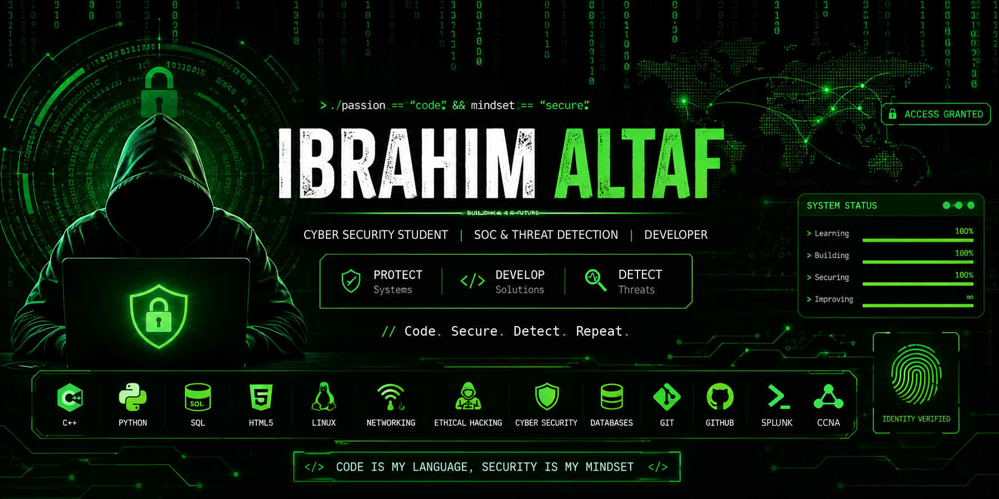

  

  

  
  
  

## 🛡️ About Me

🎓 BS Cyber Security student at the University of Management and Technology (UMT), Lahore, focused on SOC operations, threat detection, and secure software development.

I build hands-on security projects: attack detection labs, network scanners, and attack simulators, backed by CCNA and RHCSA certifications.

🎯 **Currently seeking a cybersecurity internship** where I can apply my SOC, networking, and Linux skills to real-world security work.

## 💻 Focus Areas

- SOC Operations & Threat Detection
- Network Security & Vulnerability Assessment
- Linux & Windows Server Administration
- Python Security Tooling
- Full-Stack Web Development

## 🏅 Certifications

- **CCNA**: Cisco Certified Network Associate
- **RHCSA**: Red Hat Certified System Administrator
- **Hackviser** Core Certification
- **Cybrary**: Offensive Security Operations

## 🚀 Featured Projects

| Project | What it does |
|---|---|
| [Active Directory Attack Detection Lab](https://github.com/IbrahimAltaf78/Active-Directory-Attack-Detection-Lab) | Windows Server 2022 domain with Splunk and Sysmon for threat hunting and security event analysis |
| [Cyber Attack Simulator](https://github.com/IbrahimAltaf78/Cyber_Attack_Simulator) | Gamified Python platform that simulates phishing, brute force, DDoS, and SQL injection attacks |
| [Lumina](https://github.com/IbrahimAltaf78/Lumina) | Full-stack AI chat app (React, Node/Express, MongoDB) deployed on Vercel and Railway |
| [Society Membership System](https://github.com/IbrahimAltaf78/society-membership-system) | Python and SQL Server application for managing society memberships |

## 🔨 Currently Working On

- Lumina (AI chat app)
- Healthcare Appointment System (C++)
- GitHub portfolio and project documentation

## 🌱 Currently Learning

- Splunk detection engineering
- Active Directory security
- Penetration testing

## ⚙️ Technologies & Tools

  
  
  
  

## 📊 GitHub Analytics

## 🌐 Connect With Me

  

  

